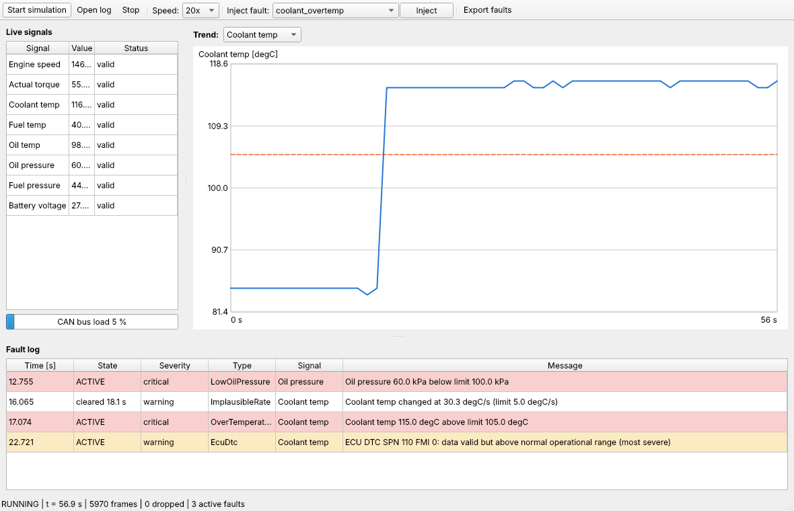
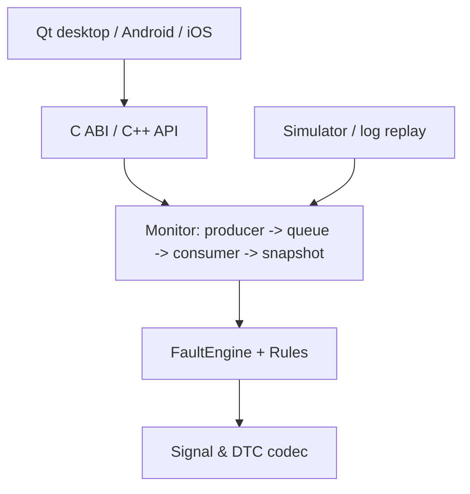
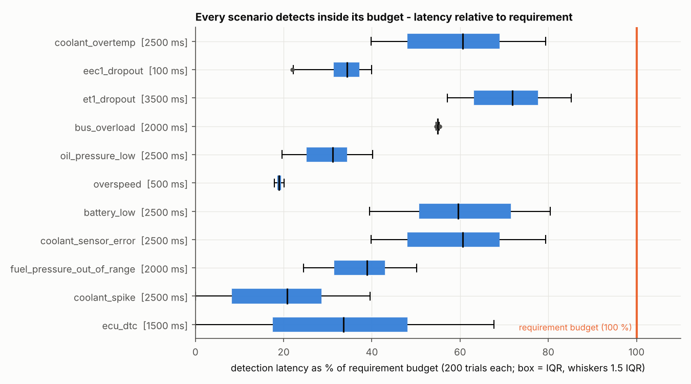

# EngineSense

[](https://github.com/idriskhansys/EngineSense/actions/workflows/ci.yml)
 

**J1939 engine diagnostics and reliability analyzer** for Windows, Android and iOS, built around a portable
C++17 core. It decodes simulated J1939/CAN telemetry, detects faults with a rule engine, and is verified
against measurable requirements with a requirements-to-test traceability matrix, FMEA-driven fault injection
and statistical analysis.



## Features
- **J1939 decoding** (CAN 2.0B, 29-bit IDs): EEC1, ET1, EFL/P1, VEP1, DM1 with SPN scaling, not-available/error
  indicators and DTC parsing.
- **Rule-based fault engine**: thresholds with hysteresis, N-sample confirmation, rate-of-change, plausibility,
  stale-message, bus-overload, ECU DTC lifecycle, consequential-fault suppression. Deterministic and extensible.
- **Fault-injection simulator**: seeded, platform-identical RNG; 11 scenarios with latency budgets.
- **Qt 6 desktop app**: live monitoring, trend plot, fault log, scenario injection, log replay, CSV export.
- **Android (NDK/JNI) and iOS (Objective-C++)** shells over one stable C ABI.
- **Engineering evidence**: 28 requirements, 105 tests, traceability matrix, FMEA, control charts, threshold tuning,
  technical report and design reviews. CI gates on warnings-as-errors, clang-tidy, cppcheck, ASan/UBSan, TSan.

## Quick start
```bash
cmake -S . -B build -DCMAKE_BUILD_TYPE=Release
cmake --build build -j
ctest --test-dir build --output-on-failure        # 105 tests

./build/apps/cli/enginesense_cli list-scenarios
./build/apps/cli/enginesense_cli simulate --seed 7 --duration 30 --inject coolant_overtemp@8 --out run.log --faults faults.csv
./build/apps/cli/enginesense_cli replay run.log

# Desktop app (needs Qt 6)
cmake -S . -B build -DENGINESENSE_BUILD_DESKTOP=ON && cmake --build build
./build/apps/desktop/enginesense_desktop
```
Sanitizers: `-DENGINESENSE_SANITIZER=address|thread`. Static analysis: `-DENGINESENSE_CLANG_TIDY=ON`.
Regression data: `tools/update_golden.sh`. Benchmarks: `enginesense_bench latency|nominal|sweep|throughput`,
then `python3 tools/analyze.py`.

## Architecture

Details: [docs/architecture.md](docs/architecture.md).

## Results (simulated bus)
| Metric | Result |
|---|---|
| Detection (11 scenarios, 200 seeds each) | 200/200 within budget; 95 % lower bound 98.5 % |
| False alarms, fault-free | 0 in 1000 simulated minutes (95 % upper bound 0.18/h) |
| Throughput | ~2.4 M frames/s (Release, single thread) |



Full analysis: [docs/results.md](docs/results.md).

## Engineering documents
- [Requirements](docs/requirements.md) and [traceability matrix](docs/traceability.md) (CI fails if a requirement has no test)
- [FMEA](docs/fmea.md)
- [Technical report](docs/technical_report.md) - root causes, corrective actions, [lessons learned](docs/technical_report.md#lessons-learned)
- Design reviews: [DR-001](docs/design_reviews/DR-001-architecture-and-interfaces.md), [DR-002](docs/design_reviews/DR-002-results-and-tuning.md)

## Layout
```
core/        portable C++17 library (no UI/OS dependencies)
apps/        cli, bench, desktop (Qt 6)
platform/    android (NDK/JNI + Kotlin), ios (Obj-C++)
tests/       GoogleTest suites, golden logs
tools/       trace, FMEA, analysis, dependency checks
docs/        requirements, traceability, FMEA, results, reports
```

## Platform notes
- **Android:** `platform/android` (Gradle + NDK). `host-test/run.sh` runs the real JNI layer on a desktop JVM.
- **iOS:** `platform/ios` (CMake Xcode generator); built on macOS CI. Not compiled in the authoring environment.

## Limitations
Simulated data only; TP.BAM multi-frame DM1 unsupported; rate-of-change rules are noise-sensitive at >= 4x
nominal noise. See the [technical report](docs/technical_report.md#5-known-limitations).

## License
MIT - see [LICENSE](LICENSE).
