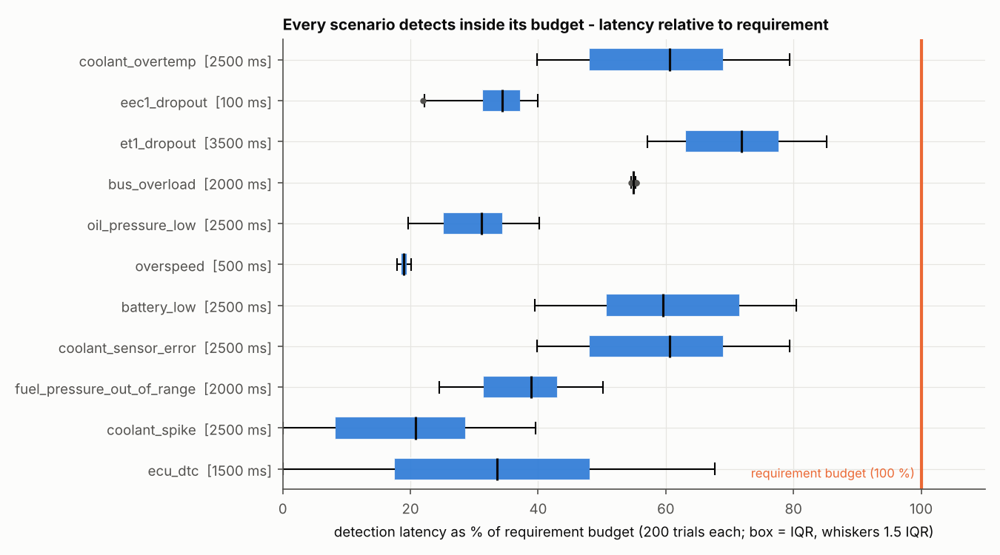
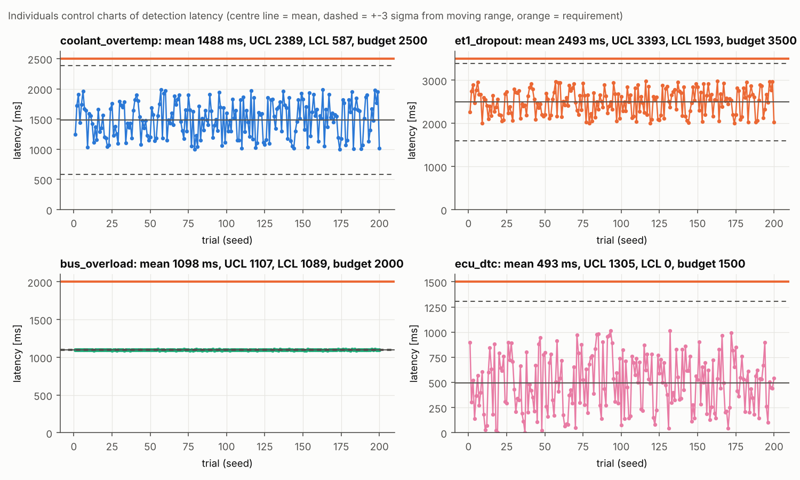
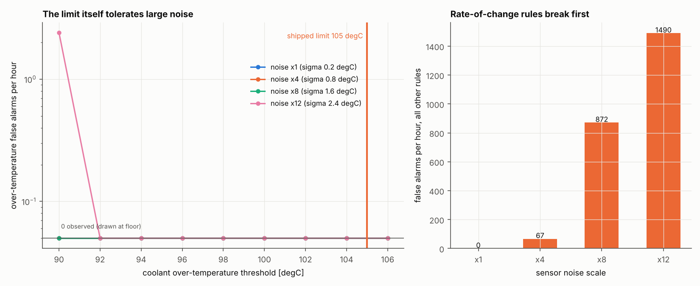
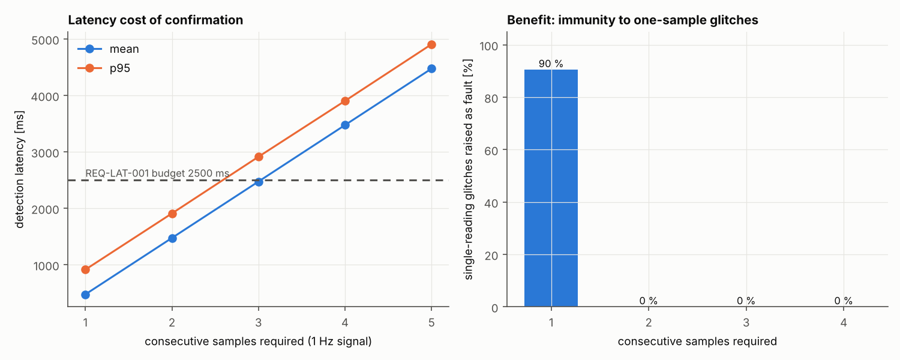

# Results

_Generated by `tools/analyze.py` from the CSVs in `docs/data/` (`enginesense_bench latency|nominal|sweep`). Re-run to refresh._

## Detection latency (200 seeds per scenario, 60 s runs, injection at 20 s + random phase)

| Scenario | Req | Detected | mean ms | sigma ms | p50 | p95 | p99 | max | budget | margin ms | Cpk | false alarms | unexpected |
|---|---|---|---|---|---|---|---|---|---|---|---|---|---|
| coolant_overtemp | REQ-LAT-001 | 200/200 | 1488 | 294 | 1515 | 1933 | 1977 | 1986 | 2500 | 514 | 1.1 | 0 | 0 |
| eec1_dropout | REQ-LAT-002 | 200/200 | 34 | 4 | 34 | 39 | 40 | 40 | 100 | 60 | 5.9 | 0 | 0 |
| et1_dropout | REQ-LAT-003 | 200/200 | 2493 | 293 | 2517 | 2938 | 2971 | 2982 | 3500 | 518 | 1.1 | 0 | 0 |
| bus_overload | REQ-LAT-004 | 200/200 | 1098 | 3 | 1098 | 1104 | 1106 | 1107 | 2000 | 893 | 101.9 | 0 | 0 |
| oil_pressure_low | REQ-LAT-005 | 200/200 | 752 | 142 | 778 | 973 | 990 | 1003 | 2500 | 1497 | 4.1 | 0 | 0 |
| overspeed | REQ-LAT-005 | 200/200 | 95 | 3 | 95 | 100 | 100 | 101 | 500 | 399 | 45.4 | 0 | 0 |
| battery_low | REQ-LAT-005 | 200/200 | 1510 | 289 | 1488 | 1959 | 2000 | 2012 | 2500 | 488 | 1.1 | 0 | 0 |
| coolant_sensor_error | REQ-LAT-005 | 200/200 | 1488 | 294 | 1515 | 1933 | 1977 | 1986 | 2500 | 514 | 1.1 | 0 | 0 |
| fuel_pressure_out_of_range | REQ-LAT-005 | 200/200 | 752 | 142 | 778 | 973 | 990 | 1003 | 2000 | 997 | 2.9 | 0 | 0 |
| coolant_spike | REQ-LAT-005 | 200/200 | 489 | 293 | 521 | 928 | 966 | 991 | 2500 | 1509 | 2.3 | 0 | 0 |
| ecu_dtc | REQ-LAT-005 | 200/200 | 493 | 275 | 503 | 914 | 995 | 1015 | 1500 | 485 | 1.2 | 0 | 0 |

One-sided 95 % lower bound on the detection rate with 200/200 detections: **98.51 %** (per scenario). Cpk = (budget - mean) / (3 sigma): how many 3-sigma widths of margin the requirement leaves.

### Control charts

Individuals charts (limits from the average moving range, 2.66 x MR-bar) show whether detection latency is stable across seeds or drifts / has special causes. Dropout latencies are uniformly distributed (the loss happens at a random phase of the message period) so they are bounded rather than bell shaped.

## False alarms on fault-free traffic

100 runs x 10 min = **1000 simulated minutes** (6.3 M frames): **0 false alarms**. Rule of three: with 0 events the 95 % upper bound on the false-alarm rate is 0.18 per hour.

## Threshold tuning and noise tolerance

Nominal coolant peaks at about 90 degC. Sweep: 20 runs x 10 min per point (3.3 h), sensor noise scaled 1x-12x. Over-temperature false alarms are counted separately from every other rule.

| noise x | sigma degC | lowest limit with 0 over-temp false alarms (any higher limit also 0) | other-rule false alarms per hour |
|---|---|---|---|
| 1 | 0.2 | 90 degC | 0 |
| 4 | 0.8 | 90 degC | 67 |
| 8 | 1.6 | 90 degC | 872 |
| 12 | 2.4 | 92 degC | 1490 |

**Finding:** the over-temperature limit is robust - even at 12x noise only the lowest tested limit (90 degC) fires - but the *rate-of-change* rules (limits of 3-5 degC/s, only ~10 sigma from nominal noise) start producing false alarms at about 4x noise. Noise immunity is therefore bounded by the rate limits, not the thresholds. Corrective action: see [technical_report.md](technical_report.md#lessons-learned).

## Debounce trade-off: confirmation samples

Requiring N consecutive samples trades latency against immunity to single-reading glitches (a +25 degC reading lasting less than one sample period).

